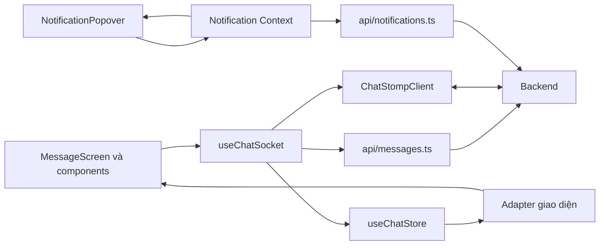
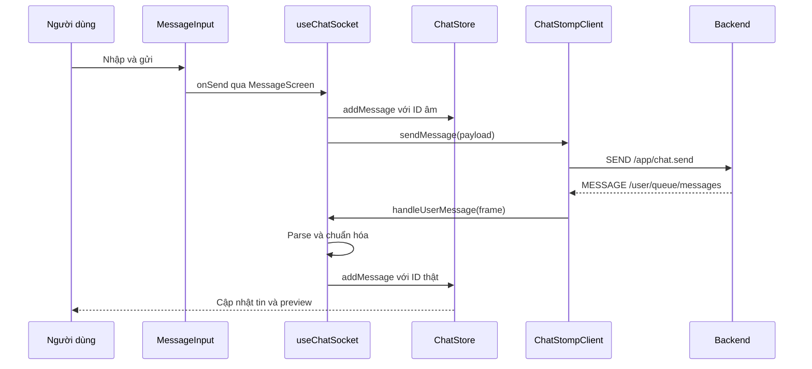
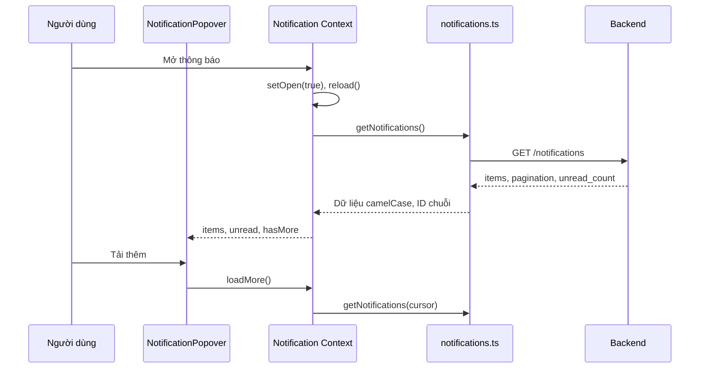

# Giải thích source code và luồng xử lý Messaging & Notification

Tài liệu chỉ mô tả module `src/modules/messaging-notification/` theo source hiện tại. Phần dưới giải thích từng file, dữ liệu đi qua các lớp và thứ tự gọi hàm trong mỗi thao tác. Các phần dùng chung chỉ được nhắc tại điểm module gọi chúng.

Chuyển chức năng từ source `Project` sang khung `Project_NewSetup`, giữ bố cục và thành phần giao diện của module cũ: nền gradient, thẻ kính, danh sách hội thoại, bong bóng tin nhắn, ô nhập, hộp xác nhận xóa và popover thông báo. Màn hình rộng từ 900px hiển thị hai cột; điện thoại chuyển giữa danh sách và hội thoại.

## Cấu trúc và quy ước

- Route `/messages` trỏ tới `screens/message/index.tsx`.
- `api/messages.ts`, `api/notifications.ts` dùng `api()` từ `@/api/backend`; không dùng Axios hoặc đọc token từ localStorage.
- `api/adapters.ts` chuyển snake_case và enum chữ HOA của REST/STOMP sang camelCase và chữ thường; ID đưa ra giao diện là chuỗi.
- `hooks/use-chat-socket.ts` quản lý kết nối, lịch sử, typing và read receipt; `store/chat-store.ts` dùng Zustand.
- `hooks/notifications-context.tsx` và `components/notification-popover.tsx` sở hữu phần thông báo. Hai file `src/context/notifications.tsx` và `src/components/notification-popover.tsx` chỉ re-export để giữ tích hợp của khung mới.
- Giao diện dùng màu và thành phần dùng chung của khung mới; gradient riêng của màn chat nằm ở `theme.ts` trong module.

## API và xác thực

Các endpoint dưới đây là những endpoint đang được source gọi. Đây không phải danh sách toàn bộ chức năng backend hỗ trợ.

| API | Chức năng |
| --- | --- |
| `GET /conversations?limit=10&after=...` | Danh sách hội thoại |
| `GET /conversations/{id}/messages?limit=100&after=...` | Lịch sử tin nhắn |
| `DELETE /messages/{id}` | Xóa ở phía tôi (`ME`) hoặc thu hồi (`EVERYONE`) |
| `GET /notifications?limit=20&after=...` | Thông báo và tổng số chưa đọc |

`src/api/backend.ts` chuẩn hóa gốc API bằng `getApiBaseUrl('api/v1')`, vì `.env` được cung cấp là domain gốc. Không thêm `/api/v1` trong từng endpoint; URL đã có tiền tố cũng không bị lặp.

```dotenv
EXPO_PUBLIC_API_URL=https://snsqb.duckdns.org
EXPO_PUBLIC_WS_URL=https://snsqb.duckdns.org/api/v1/ws
```

STOMP dùng WebSocket thuần tại `wss://snsqb.duckdns.org/api/v1/ws/websocket`. Token lấy từ `getAccessToken()` mỗi CONNECT; khi xác thực bị từ chối, gọi `refreshAccessToken()` của lớp dùng chung và thử lại một lần theo `QUY_UOC.md`.

Publish `/app/chat.send`, `/app/chat.read`, `/app/chat.typing`; subscribe `/user/queue/messages`. Payload đi qua adapter trước khi gửi và sau khi nhận, giữ nguyên nội dung tin nhắn.

## Hành vi giữ từ bản cũ

- Tin gửi hiển thị ngay với ID tạm âm. Broadcast của server thay thế tin tạm; bỏ chữ “Đang gửi” sau khi publish trên kết nối mở chỉ phản ánh trạng thái truyền, không xác nhận server đã lưu.
- Reconnect theo backoff 1–30 giây, đăng ký lại subscription và gửi hàng đợi sau khi kết nối lại. Dọn hàng đợi, store và subscription khi dispose để không chuyển tin sang phiên đăng nhập khác.
- Web giữ kết nối khi đổi tab. Native ngắt khi vào nền và kết nối lại khi quay về foreground.
- Typing gửi bắt đầu/kết thúc, dừng sau 2 giây không nhập. Hội thoại đang mở gửi read receipt khi ứng dụng active.
- Xóa/thu hồi cần xác nhận và thành công từ API trước khi cập nhật store. ID tạm không được xóa. Store ghi nhớ thao tác xóa để snapshot cũ không làm nội dung xuất hiện lại.
- Chuông thông báo tải trang đầu khi khởi tạo và mỗi lần mở, hỗ trợ làm mới/tải thêm/thử lại. Badge dùng `unread_count` từ server. Hiển thị title, body, icon, actor, thời gian, metadata và trạng thái đọc từ API.

Phạm vi vẫn như bản cũ: màn chat gửi văn bản, chưa có giao diện tạo hội thoại mới, upload media, quản lý nhóm hoặc tải thêm lịch sử/hội thoại. Thông báo chỉ đọc danh sách, chưa gọi API đánh dấu đọc, push notification hoặc điều hướng target. Thu hồi phía người khác cập nhật khi tải lại lịch sử; chưa thêm xử lý sự kiện thu hồi realtime.

## Cấu hình và kiểm tra

Module chỉ dùng API và WebSocket thật; cần cấu hình `EXPO_PUBLIC_API_URL` và `EXPO_PUBLIC_WS_URL` cùng tài khoản hợp lệ. Không còn dữ liệu demo, nhánh mock hoặc file test trong module.

```powershell
npm run lint
npx tsc --noEmit
```

## 1. Bản đồ từng file

Các đường dẫn trong bảng tính từ `src/modules/messaging-notification/`.

| File | Trách nhiệm |
| --- | --- |
| `screens/message/index.tsx` | Ghép màn hình, giữ hội thoại đang chọn, đọc store và nối callback gửi/xóa/typing với giao diện. |
| `hooks/use-chat-socket.ts` | Điều phối REST, vòng đời socket, nhận sự kiện, gửi tin, typing và đã đọc. |
| `store/chat-store.ts` | Lưu dữ liệu chat trong bộ nhớ bằng Zustand và cung cấp action cập nhật dữ liệu. |
| `api/messages.ts` | Các hàm REST lấy hội thoại, lấy lịch sử, xóa/thu hồi tin. |
| `api/notifications.ts` | Tải một trang thông báo, kiểm tra tham số, chuẩn hóa ID. |
| `api/adapters.ts` | Chuyển định dạng backend sang dữ liệu nội bộ/giao diện và chiều gửi ngược lại. |
| `api/interfaces/messages.interface.ts` | Kiểu dữ liệu REST: `Conversation`, `ConversationMessage`, phân trang, kết quả xóa. |
| `api/types/types.ts` | Hai kiểu phục vụ UI: `ConversationItemData` và `MessageItemData`. |
| `api/realtime/stomp.config.ts` | URL socket, destination STOMP, heartbeat và thời gian reconnect. |
| `api/realtime/stomp.types.ts` | Kiểu request/event, đọc JSON, nhận diện và chuẩn hóa sự kiện realtime. |
| `api/realtime/stomp.client.ts` | Vận chuyển STOMP: xác thực, kết nối, subscribe, publish, hàng đợi, reconnect. |
| `hooks/notifications-context.tsx` | State thông báo: danh sách, số chưa đọc, đóng/mở, tải trang và lỗi. |
| `components/notification-popover.tsx` | Cửa sổ thông báo, nút làm mới, thử lại, tải thêm. |
| `components/conversation-list.tsx` | Danh sách hội thoại và tìm kiếm cục bộ theo tên. |
| `components/conversation-item.tsx` | Một dòng hội thoại: avatar, tên, preview, giờ và badge chưa đọc. |
| `components/chat-window.tsx` | Header, danh sách tin, dòng typing, ô soạn và modal xóa. |
| `components/message-input.tsx` | Văn bản đang soạn, kiểm tra gửi rỗng, callback gửi và typing. |
| `components/message-bubble.tsx` | Bong bóng tin, thời gian, trạng thái và nút tùy chọn. |
| `components/avatar.tsx` | Hiện ảnh theo URL hoặc chữ đầu tên; nếu tên rỗng thì dùng `?`. |
| `components/glass-card.tsx` | Khung `View` có màu, viền và bóng theo theme chung. |
| `theme.ts` | Ba màu gradient nền của màn chat. |

## 2. Kiến trúc tổng thể



REST lấy dữ liệu có sẵn và xử lý xóa; STOMP gửi/nhận sự kiện chat. Zustand giữ dữ liệu chat để UI tự render khi dữ liệu thay đổi. Thông báo dùng React Context riêng, không dùng chat store hay subscription của chat.

## 3. Dữ liệu đi qua những lớp nào?

### Backend → dữ liệu nội bộ

Backend dùng `conversation_id`, `message_id`, `message_type`, enum `TEXT`, `NEW_MESSAGE`. `fromApi()` đổi tên trường snake_case sang camelCase đệ quy qua object và array. Với các trường enum khai báo trong `enumKeys`, nó chuyển chữ thường và thay `_` bằng `-`.

Ví dụ `message_type: "TEXT"` trở thành `messageType: "text"`. Nội dung tin nhắn không bị đổi chữ hoa/thường. `fromApi()` cũng không tự chuyển tất cả ID chuỗi thành số.

`toApi()` thực hiện chiều gửi đi cho trường cấp đầu của object: `conversationId` → `conversation_id`, `messageType: "text"` → `message_type: "TEXT"`. Hàm này không chuyển đệ quy mọi object lồng nhau.

### Dữ liệu nội bộ → giao diện

`ChatMessage` mở rộng `WsNewMessageEvent` bằng `pending`, `failed`, `revoked`. Hook chuyển lịch sử REST thành cấu trúc giống tin realtime, giúp store xử lý chung một dạng dữ liệu.

`toConversationItem()` lấy ID, tên, avatar, preview, giờ và số chưa đọc. `toMessageItem()` lấy nội dung, giờ, trạng thái; tính `mine` bằng cách so sánh ID người gửi với ID tài khoản hiện tại. ID đưa ra UI là chuỗi.

Kiểu `Id` nội bộ hiện là `number`. Bộ chuẩn hóa tin realtime chuyển chuỗi số sang số. Store dùng `String(id)` khi gộp danh sách để `152` và `"152"` không tạo hai bản ghi có cùng key hiển thị.

## 4. Màn hình và component hoạt động thế nào?

### `MessageScreen`

State `selected` giữ hội thoại đang chọn. Màn hình đọc `conversations`, `messages[selectedId]`, `typing[selectedId]` từ store, rồi gọi adapter trước khi truyền cho component. `EMPTY_MESSAGES` là mảng rỗng dùng lại khi chưa có tin, tránh tạo mảng mới mỗi lần selector đọc store.

Chiều rộng từ 900 trở lên hiển thị sidebar rộng 360 và chat cạnh nhau. Màn hình nhỏ hiển thị danh sách khi chưa chọn hội thoại; sau khi chọn thì hiện chat. Nút quay lại đặt `selected` về null.

`handleSend()` tạo request văn bản với `mediaUrls: []`, `replyToMessageId: null`. `handleDelete()` chờ REST thành công rồi mới cập nhật store.

### Danh sách hội thoại

`ConversationList` giữ ô tìm kiếm, dùng `useMemo` lọc tên các hội thoại **đã tải**, không tìm trên server. Nó ưu tiên hiển thị loading, lỗi, rồi danh sách. Nút thử lại gọi callback của hook.

`ConversationItem` hiển thị avatar, tên, preview một dòng, giờ và badge nếu có tin chưa đọc. Bấm vào dòng gọi `onSelect` để đổi `selected` ở màn hình.

### Khung chat và vị trí cuộn

`ChatWindow` dùng `[...messages].reverse()` để tạo bản sao mới nhất trước, rồi truyền vào `FlatList inverted`. Tin mới nhất nằm phía dưới ngay khi mở, không cần gọi `scrollToEnd()` lặp lại sau mỗi thay đổi kích thước nội dung.

Key của danh sách là `messages-${conversation.id}`; key của ô soạn là `composer-${conversation.id}`. Hai component cùng cấp có key khác nhau. Khi đổi hội thoại, key đổi giúp tạo lại danh sách và reset văn bản đang soạn. Key từng dòng tin vẫn là ID tin nhắn.

Dòng typing có chiều cao cố định, hiển thị khoảng trắng khi không có ai nhập để hạn chế thay đổi chiều cao vùng danh sách.

### Ô nhập và bong bóng

`MessageInput` giữ `text`. Mỗi thay đổi gọi `onTypingChange(value.trim().length > 0)`. Khi gửi, nó trim nội dung, gọi `onSend`, xóa text và báo dừng typing. Khi blur cũng báo dừng typing. Nút gửi bị khóa nếu nội dung chỉ có khoảng trắng.

`MessageBubble` căn phải tin của mình, căn trái tin người khác. Tin revoked hiện câu “Tin nhắn đã được thu hồi”. Nút tùy chọn chỉ hiện với ID dương và tin không pending. Component có giao diện `failed`, nhưng luồng socket hiện chưa tự đánh dấu lỗi gửi cho từng tin.

## 5. Luồng mở màn hình và chọn hội thoại

1. Màn hình gọi `useChatSocket(selectedId hoặc null)`.
2. Khi đã đăng nhập, effect lấy client và bắt đầu kết nối. Thiếu `EXPO_PUBLIC_WS_URL` thì báo lỗi cấu hình.
3. Hook lên lịch tải danh sách ban đầu. Callback STOMP `onConnect` cũng tải lại danh sách và lịch sử hội thoại đang mở nếu có.
4. `getConversations()` gọi REST; kết quả qua `setConversations()` rồi adapter để hiển thị.
5. Khi người dùng chọn hội thoại, `activeConversationId` thay đổi. Nếu socket connected, hook tải lịch sử hội thoại đó.
6. `loadMessages()` lọc tin hidden, sắp theo ID, đổi sang `ChatMessage` và gọi `setMessages()`.
7. Store gộp REST với cache/realtime, áp dụng dấu xóa/thu hồi, sắp theo `createdAt` và ID khi cùng thời gian.
8. Nếu đây vẫn là hội thoại đang mở, hook đánh dấu đọc và gửi receipt cho tin cuối.

Loading lịch sử chỉ bật khi chưa có tin trong cache. Cache nằm trong bộ nhớ, không lưu xuống thiết bị.

`requestGeneration` bỏ qua kết quả REST thuộc vòng đời hook đã dọn. `activeConversationRef` giúp callback bất đồng bộ biết hội thoại đang mở hiện tại. Lịch sử của hội thoại khác vẫn có thể được lưu cache nhưng không được xử lý như hội thoại đang mở ở bước đánh dấu đọc.

## 6. Luồng gửi và nhận tin nhắn



### Gửi tin

`sendMessage()` dừng typing, tạo ID tạm bằng `-Date.now()`, thêm tin ngay vào store với `pending: true`. Đây là hiển thị trước khi backend phản hồi.

Sau khi gọi client, nếu socket connected thì `markMessageSent()` đặt pending false. Bỏ nhãn “Đang gửi...” ở đây không chứng minh backend đã lưu thành công.

Payload sau adapter có dạng:

```json
{
  "conversation_id": 42,
  "content": "Chào bạn",
  "message_type": "TEXT",
  "media_urls": [],
  "reply_to_message_id": null
}
```

Đây là body frame STOMP SEND, không phải HTTP POST.

### Nhận tin

`parseWsPayload()` đọc JSON và gọi `fromApi()`; JSON lỗi trả null. Hook nhận diện lần lượt typing, tin mới và đã đọc. Payload không nhận diện được được log tên các trường để chẩn đoán.

`isWsNewMessageEvent()` kiểm tra ID, người gửi và nội dung; hỗ trợ object bọc trong `data`, `message` hoặc `payload`. `normalizeWsNewMessageEvent()` chuyển về một cấu trúc, ép ID sang số và điền giá trị mặc định cho trường thiếu.

Với tin mới, hook gọi `addMessage()`. Nếu thuộc hội thoại đang mở thì đánh dấu đọc. Nếu thuộc hội thoại khác, chưa nhận trước đó và người gửi không phải mình thì tăng số chưa đọc. Nếu chưa biết hội thoại, hook tải lại danh sách REST ở chế độ silent để lấy metadata.

### Ghép tin tạm và chống trùng

`addMessage()` bỏ qua ID đã có mà không pending. Tin thật mới thay thế một tin ID âm có cùng người gửi, nội dung và loại tin. Tin giống nội dung nhưng khác người gửi không bị gộp.

Đây là đối chiếu theo nội dung, chưa có mã request riêng để ghép tuyệt đối chính xác. Gửi liên tiếp nhiều tin giống nhau hoặc REST trả tin thật trước broadcast có thể làm việc ghép khó phân biệt; `setMessages()` gộp theo ID, không tự ghép ID âm với ID thật.

Store cập nhật preview nếu tin mới không cũ hơn preview hiện tại và sắp hội thoại theo hoạt động mới nhất.

## 7. Các state và action của chat store

| State | Ý nghĩa |
| --- | --- |
| `conversations` | Hội thoại đã tải. |
| `messages[conversationId]` | Tin đã tải, tin tạm và tin nhận realtime. |
| `typing[conversationId]` | Một người đang nhập hoặc null. |
| `deleted[conversationId][messageId]` | Scope xóa đã thực hiện trong phiên để dữ liệu cũ không khôi phục nội dung. |
| `connection` | disconnected, connecting hoặc connected. |

| Action | Xử lý |
| --- | --- |
| `setConversations` | Thay danh sách, loại ID trùng bằng khóa chuỗi. |
| `setMessages` | Gộp REST/cache theo ID; cache được ưu tiên trừ khi bản REST đã revoked; áp dụng dấu xóa và sắp thời gian. |
| `addMessage` | Chống trùng, thay một tin tạm, thêm tin, cập nhật preview và thứ tự hội thoại. |
| `markMessageSent` | Tắt pending cho ID tạm chỉ định. |
| `applyDelete` | Xóa khỏi UI hoặc giữ dạng revoked, cập nhật preview nếu cần. |
| `applyRead` | Thêm reader và thời gian vào `readBy` của tin có ID khớp. |
| `applyTyping` | Lưu event khi đang nhập, đặt null khi dừng. |
| `markRead` | Đặt số chưa đọc hội thoại về 0 ở phía giao diện. |
| `incrementUnread` | Tăng số chưa đọc của hội thoại. |
| `setConnection` | Đổi trạng thái kết nối. |
| `clearChat` | Xóa dữ liệu, typing, dấu xóa và trạng thái kết nối. |

## 8. Luồng typing

1. Ô nhập báo true khi có nội dung sau trim.
2. Hook chỉ gửi khi socket connected. Map `typingState` tránh gửi true trên từng phím khi đã báo bắt đầu.
3. Mỗi phím đặt lại timer 2 giây; hết timer gọi gửi false.
4. Xóa hết nội dung, gửi tin hoặc blur cũng báo false nếu trước đó đang typing.
5. Đổi/rời hội thoại thì cleanup dọn timer, gửi false cho hội thoại cũ.
6. Native vào nền thì dừng typing trước khi ngắt socket. Disconnect xóa trạng thái typing gửi đi để lần nhập sau báo true lại.
7. Phía nhận đọc event từ `/user/queue/messages`, bỏ qua event của chính mình và gọi `applyTyping()`.
8. Màn hình tạo dòng `Tên người dùng đang nhập...` từ state của hội thoại đang chọn.

Request bắt đầu là `{ "conversation_id": 42, "typing": true }`; kết thúc đổi `typing` thành false. Trường gửi là `typing`, không phải `is_typing`.

`normalizeWsTypingBroadcast()` hỗ trợ dữ liệu nội bộ đã có `isTyping` hoặc dạng nhận có `typing` và object `user`. Bộ nhận diện hiện yêu cầu event `typing-status`, conversation ID dạng số và timestamp dạng chuỗi.

Client không xếp hàng typing khi offline. Phía nhận chưa có timer tự hết hạn; mất event false có thể khiến dòng typing còn hiện. Store chỉ giữ một người mỗi hội thoại, chưa tổng hợp nhiều người đang nhập trong nhóm.

## 9. Luồng đã đọc

Khi tải xong lịch sử hoặc nhận tin thuộc hội thoại đang mở, hook gọi `markRead()` cho UI và `sendRead()` cho backend.

`sendRead()` kiểm tra AppState active, dùng Map `lastRead` để tránh gửi lặp cùng ID cuối. Destination `/app/chat.read` nhận `conversation_id` và `message_id`.

Event `message-read` nhận về gọi `applyRead()` để thêm reader vào đúng tin. UI chưa hiển thị “Đã xem”. Việc đặt unread cục bộ và gửi receipt là hai thao tác riêng; guard AppState nằm trong bước gửi receipt.

## 10. Luồng xóa/thu hồi

1. Bấm dấu ba chấm của tin có ID thật; `ChatWindow` lưu `actionMessage`, mở modal.
2. Chọn “Xóa ở phía tôi” hoặc “Thu hồi với mọi người”. Thu hồi chỉ hiện cho tin của mình chưa revoked.
3. Xác nhận; `deleting` chặn bấm lặp. `confirmDelete()` gọi callback `onDelete`.
4. `MessageScreen.handleDelete()` gọi `deleteMessage()` và chờ REST thành công.
5. `applyDelete()` lọc tin nếu scope me; với everyone thì giữ tin, xóa nội dung/media và đặt revoked.
6. Nếu tin là preview cuối, store xóa preview hoặc thay bằng câu thu hồi. Dấu xóa được giữ để snapshot sau không phục hồi tin.
7. Nếu REST lỗi, modal hiện lỗi và giữ lại; store không xóa như thể thành công.

Hàm REST từ chối ID không phải số nguyên dương an toàn và scope không hợp lệ. Body dùng enum `ME`/`EVERYONE` qua adapter. Hook chưa có nhánh nhận `MESSAGE_REVOKED`; thu hồi do người khác cần được phản ánh qua lần tải lịch sử tiếp theo.

## 11. STOMP client và vòng đời kết nối

`getChatStompClient()` giữ singleton của module. Client vận chuyển frame, hook quyết định cập nhật store; client không tự gọi Zustand.

| Hàm/callback | Vai trò |
| --- | --- |
| `beforeConnect` | Lấy token hiện tại, gắn `Authorization: Bearer ...` vào CONNECT. |
| `connect` | Tránh kích hoạt lại client đang active, gắn handler rồi activate. |
| `onConnect` | Reset bộ đếm, subscribe queue riêng, flush hàng đợi rồi gọi hook. |
| `publish` | Adapter → JSON → STOMP; nếu offline thì thêm frame vào hàng đợi bộ nhớ. |
| `sendTyping` | Chỉ publish khi connected, không giữ trạng thái typing cũ trong hàng đợi. |
| `onStompError` | Nhận diện một số lỗi token qua nội dung; refresh và thử lại theo giới hạn. Lỗi khác báo lên hook. |
| `onWebSocketClose` | Báo disconnected, lên lịch reconnect nếu được phép. |
| `scheduleReconnect` | Chờ tăng dần từ 1 giây, tối đa 30 giây; deactivate trước activate lại. |
| `disconnect` | Tắt reconnect, hủy timer/subscription, ngắt socket; còn giữ hàng đợi. |
| `dispose` | Disconnect, xóa hàng đợi và giải phóng singleton. |

Heartbeat outgoing là 10 giây, incoming là 0, cấu hình retry xác thực tối đa 1. `onUnhandledMessage` log destination và subscription khi frame không khớp subscription.

URL cấu hình HTTP(S) được đổi thành WS(S) và thêm `/websocket`. Source dùng WebSocket thuần, không tạo đối tượng SockJS.

Web giữ kết nối khi đổi tab; native ngắt khi inactive/background và nối lại khi active. Cleanup của hook dọn timer, dừng typing nếu cần, dispose client, xóa cache read/typing và clear store. Hàng đợi không lưu bền: tải lại trang hoặc dispose sẽ mất các frame chưa gửi.

## 12. Luồng thông báo



### API thông báo

`getNotifications(after?, limit=20)` kiểm tra limit là số nguyên 1–50 và cursor là số nguyên dương an toàn nếu có. Dữ liệu trả về đi qua `fromApi()`, sau đó ID thông báo, actor, target và câu hỏi trong metadata được chuyển thành chuỗi.

### Context thông báo

`NotificationProvider` lấy `user.id` làm key cho `UserNotifications`. Đổi tài khoản sẽ tạo lại state bên trong để không giữ danh sách cũ.

State gồm `items`, `unread`, `open`, `loading`, `error`, `hasMore`. Ref `cursor` giữ vị trí trang; `busy` chặn request đồng thời; `generation` bỏ qua kết quả thuộc vòng đời đã kết thúc.

`fetchPage(false)` thay danh sách bằng trang đầu. `fetchPage(true)` nối trang mới. Cả hai dùng Map theo notification ID để tránh trùng. Số chưa đọc lấy trực tiếp từ backend, không đếm từ riêng các item đã tải.

Cursor lấy từ `pagination.after`, nếu thiếu thì dùng ID item cuối. `hasMore` yêu cầu server báo trang tiếp và cursor dùng được; khi nối trang, cursor phải khác cursor cũ để tránh tải lặp.

Context tải lúc mount; mỗi lần mở popover cũng reload. Nếu đang busy thì không tạo thêm request. `loadMore()` chỉ chạy khi hasMore.

### Popover thông báo

Khi đóng, component trả null. Khi mở, có lớp nền bấm để đóng và khung giới hạn theo kích thước màn hình/safe area.

Mỗi item hiện title, body, icon hoặc icon mặc định, actor nếu có, metadata câu hỏi xác nhận và giờ theo locale `vi-VN`. `readAt` quyết định nền và chấm chưa đọc.

Nút làm mới gọi reload; nút tải thêm gọi loadMore. Khi lỗi, thử lại sẽ tải tiếp nếu đang có item và còn trang, nếu không thì tải lại trang đầu. Mở popover không tự gọi đánh dấu đã đọc.

## 13. Những giới hạn cần hiểu khi đọc source

| Phần | Trạng thái hiện tại |
| --- | --- |
| Phân trang chat | API có after nhưng UI chưa có nút/cơ chế tải thêm lịch sử hoặc hội thoại. |
| Media, reply, reaction | Type có trường tương ứng nhưng màn hình chỉ gửi văn bản. |
| Quản lý hội thoại | Chưa có tạo hội thoại hoặc quản lý nhóm trong UI. |
| Giao nhận tin | Chưa có xác nhận lưu/retry từng tin; bỏ pending không bảo đảm server đã lưu. |
| Đã xem | Store lưu readBy, UI chưa hiển thị. |
| Typing nhóm | Một người mỗi hội thoại, chưa có timeout ở phía nhận. |
| Thông báo | Chỉ REST, chưa push/realtime, đánh dấu đọc hay điều hướng target. |
| Dữ liệu phiên | Store, hàng đợi và dấu xóa chỉ nằm trong bộ nhớ. |

## 14. Thứ tự đọc source và tìm lỗi

Đọc chat theo thứ tự: `screens/message/index.tsx` → components → `use-chat-socket.ts` → `chat-store.ts` → API/adapters → STOMP types/client/config. Đọc thông báo theo thứ tự: `notifications-context.tsx` → `notifications.ts` → `notification-popover.tsx`.

| Hiện tượng | Chỗ cần kiểm tra |
| --- | --- |
| Không tải lịch sử/hội thoại | Network REST, messages.ts, loadMessages/loadConversations. |
| Socket không kết nối | URL, token, callback lỗi và reconnect. |
| Nhận frame nhưng UI không đổi | parseWsPayload, isWs..., handleUserMessage, store. |
| Tin/key trùng | ID REST/realtime, ghép tin tạm, key của component cùng cấp. |
| Typing không hiện | Field typing, dạng event nhận, user ID và hội thoại đang chọn. |
| Xóa thất bại | ID thật, scope, body và response của DELETE. |
| Thông báo tải lặp | pagination, cursor, busy, generation và Map loại trùng. |

`[Chat] STOMP CONNECTED` là log thành công ở chế độ phát triển. HTTP 400 cần xem URL, method và response cụ thể trong Network, không thể xác định nguyên nhân từ một dòng status chung.

Sau khi thay đổi logic cần thử bằng hai tài khoản thật: mở hội thoại, gửi/nhận, dừng typing, đổi hội thoại, xóa/thu hồi, mất mạng và kết nối lại. Với thông báo, thử tải đầu, mở lại, tải thêm và đổi tài khoản.
